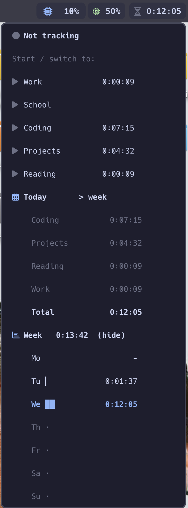

# sketchybar-timewarrior

A [Timewarrior](https://timewarrior.net) time tracker for [SketchyBar](https://github.com/FelixKratz/SketchyBar).
Start, switch, pause and stop categories from the bar, and see your totals in a dropdown menu.
Everything is recorded in Timewarrior, so `timew summary` and your existing workflow keep working.



## Features

- **Live timer** in the bar while tracking, to the second: `Coding 1:12:34`
- **Click for the menu**:
  - start a category, or switch while tracking
  - pause / resume and stop
  - today's time next to every category
  - totals per category for **today, this week or this month** (click the header to cycle)
  - a **week chart** with Monday–Sunday bars (click its header to hide it)
  - updates live, and highlights the row under your mouse
- **Right-click** the bar item to pause / resume without opening the menu
- **Pause keeps your time**: resuming continues the session instead of starting from zero
- **Auto-pause** when the screen locks or the Mac sleeps, with a "Resume?" prompt when you're back.
  Sleep is detected from the bar itself: the time is cut at the last second the timer was seen running.
  Restarting SketchyBar never cuts your time
- **Long-session warning**: the timer turns orange after 3 hours (configurable)
- **Idle** shows today's total
- **Light on resources**: ticks every second but only asks Timewarrior every 10 seconds
  (every second while the menu is open; the menu closes itself after 2 minutes)

## Requirements

- [SketchyBar](https://github.com/FelixKratz/SketchyBar)
- Timewarrior: `brew install timewarrior`
- A [Nerd Font](https://www.nerdfonts.com) for the icons. Default: Hack Nerd Font (`brew install --cask font-hack-nerd-font`)
- `/usr/bin/python3`, which comes with the Xcode Command Line Tools (`xcode-select --install`)

## Installation

1. Copy the `timewarrior` folder into your SketchyBar plugins folder:

   ```bash
   git clone https://github.com/LucasOesterbye/sketchybar-timewarrior.git /tmp/sketchybar-timewarrior
   cp -r /tmp/sketchybar-timewarrior/timewarrior ~/.config/sketchybar/plugins/
   chmod +x ~/.config/sketchybar/plugins/timewarrior/*
   ```

2. Add this line to your `sketchybarrc`, where you want the item to appear:

   ```bash
   source "$CONFIG_DIR/plugins/timewarrior/item.sh"
   ```

3. Reload: `sketchybar --reload`

## Configuration

Edit `plugins/timewarrior/config.sh`, then reload SketchyBar:

| Setting | Default | Description |
|---|---|---|
| `TW_TAGS` | `Work;School;Coding;Projects;Reading` | Categories in the menu, separated by `;` |
| `TW_POSITION` | `right` | `left`, `right` or `center` |
| `TW_WARN_HOURS` | `3` | Turn the timer orange after this many hours (`0` = off) |
| `TW_AUTO_PAUSE` | `1` | Pause when the screen locks or the Mac sleeps (`0` = off) |
| `TW_RESUME_PROMPT` | `1` | When you're back: `1` = "Resume?" dialog, `0` = only a notification |
| `TW_FONT` | `Hack Nerd Font` | Nerd Font for icons and text |
| `TW_ACTIVE`, `TW_PAUSED`, … | Catppuccin Mocha | Colours |

The item inherits your bar's `--default` styling (background, paddings), so it matches your other items.

## Keyboard shortcut (optional)

Bind `action.sh toggle` to a key to pause / resume from anywhere. When nothing is running it opens the menu instead.

[AeroSpace](https://github.com/nikitabobko/AeroSpace), in `[mode.main.binding]`:

```toml
alt-shift-p = 'exec-and-forget CONFIG_DIR=$HOME/.config/sketchybar $HOME/.config/sketchybar/plugins/timewarrior/action.sh toggle'
```

AeroSpace's default `[exec.env-vars]` puts `/opt/homebrew/bin` on the `PATH`. On an Intel Mac, add `/usr/local/bin`:

```toml
[exec.env-vars]
    PATH = '/opt/homebrew/bin:/opt/homebrew/sbin:/usr/local/bin:${PATH}'
```

With other hotkey tools (skhd and the like), make sure Homebrew's `bin` folder is on the `PATH` of the command.

Used Timewarrior in the terminal? The bar notices within 10 seconds, or right away after
`sketchybar --trigger timew_update`.

## How pause works

Timewarrior has no pause. **Pause** stops the current interval and remembers the session time; **Resume** runs
`timew continue` and the bar keeps counting from where you paused. Your Timewarrior totals stay correct; a paused
session simply shows up as two intervals.

## Privacy

Everything stays on your Mac. The plugin only talks to your local Timewarrior (`timew export`, `start`, `stop`,
`continue`) and never touches the network.
It keeps a few tiny state files (current category, start time, menu settings) in
`~/Library/Caches/sketchybar-timewarrior`, a folder only your user can read. Delete it any time to reset.

## Files

| File | Purpose |
|---|---|
| `item.sh` | Creates the bar item and the menu (sourced from `sketchybarrc`) |
| `config.sh` | Your settings |
| `lib.sh` | Shared helpers, state files and the one place that asks Timewarrior what's running |
| `timew.sh` | Updates the bar item; left-click opens the menu, right-click pauses |
| `menu.sh` | Fills the menu |
| `action.sh` | Start, pause / resume, stop, summary range, chart toggle |
| `away.sh` | Auto-pause on lock / sleep and the "Resume?" prompt |
| `hover.sh` | Highlights the menu row under the mouse |
| `stats.py` | Totals and the week chart from `timew export` |

## Uninstall

Remove the `source` line from `sketchybarrc`, then:

```bash
rm -r ~/.config/sketchybar/plugins/timewarrior ~/Library/Caches/sketchybar-timewarrior
sketchybar --reload
```

## License

MIT
